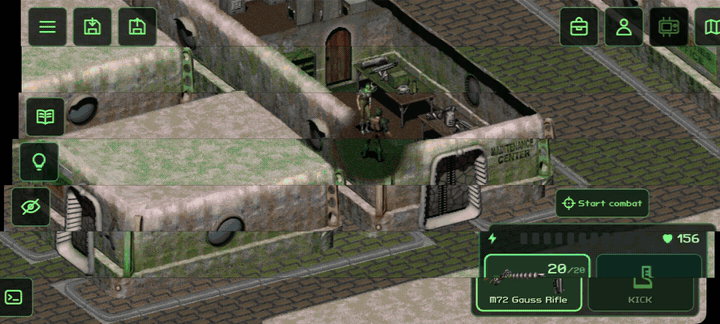

# Fallout 2 CE Mobile (F2 Touch, неофициальная)

[English version](README.md)

**Сенсорный порт для вашей копии Fallout 2.** Все экраны игры переделаны под пальцы: без курсора, ничего не нужно переключать. Приложение для Android и веб-приложение для iPhone и iPad, которое ставится на экран «Домой» и работает без интернета. Телефоны и планшеты, альбомная ориентация. Основан на [Fallout 2: Community Engine](https://github.com/fallout2-ce/fallout2-ce). Бесплатно. **Бета.**

**[Android: скачать APK](https://github.com/imbaner/fallout2-ce-mobile/releases/latest)** · **[iPhone и iPad: play.f2touch.com](https://play.f2touch.com)** · [Telegram](https://t.me/imbaner) · [YouTube](https://www.youtube.com/@imbaner_dev) · [Сообщить об ошибке](https://github.com/imbaner/fallout2-ce-mobile/issues)

Это **неофициальная любительская изменённая версия** Fallout 2 CE. Она не связана с Microsoft, Bethesda Softworks, ZeniMax Media и Interplay и не одобрена ими. Fallout — товарный знак его владельцев. В приложении **нет данных игры**: нужна ваша собственная копия Fallout 2 ([GOG](https://www.gog.com/game/fallout_2), [Steam](https://store.steampowered.com/app/38410), [Epic Games](https://store.epicgames.com/p/fallout-2)).

## В игре

<p align="center"></p>

## Что изменено (уведомление об изменении ПО)

Поверх CE (его движок, исправления и совместимость с sfall сохранены и обновляются из оригинала):

- **Сенсорный интерфейс.** Экраны игры заменены экранами для пальцев и разрешения телефона: диалог, торговля, инвентарь, обыск, персонаж и повышение уровня, создание персонажа, Pip-Boy (задания, голодиски с озвучкой, карты, видео, отдых), автокарта, карта мира и карты городов, навыки, меню игры, настройки, сохранение и загрузка, главное меню, окна сообщений, прицельный выстрел. Без курсора: касание — действие, долгое нажатие — меню действий, перетаскивание — перенос вещей, два пальца — масштаб карты.
- **Планшеты.** Экраны игры открываются окнами поверх мира, раскладка рассчитана на экраны планшетов (и 4:3); размер интерфейса подстраивается под экран и меняется в настройках.
- **HUD.** Кнопки у краёв экрана (размеры в dp), обе руки с режимами атаки и ОД, перезарядка, начало и конец боя, конец хода, журнал сообщений. Кнопка подсветки показывает и контейнеры, и тела с добычей (в настройках).
- **Тактический вид в бою** (кнопка, отключается в настройках): фигуры становятся полупрозрачными, гексы, куда можно дойти, и клетки персонажей рисуются на земле — можно выбрать клетку за врагом и выбрать врага по его клетке.
- **Возможности модов встроены**, где сами моды не работают на CE: фильтры и вкладки напарников Inventory Filter при обыске и торговле; Hero Appearance из sfall (раса и причёска, с RPU) — вкладкой при создании персонажа.
- **Сохранения.** Список по времени создания, быстрые сохранения никогда не затирают обычные (их число — настройка), «Продолжить» в главном меню, восстановление прерванной записи, отметки сохранений, сделанных с другими файлами игры или модами.
- **Приложение Android.** Файлы игры импортируются из папки или любого архива (.zip, .7z, .rar, .tar…), скопированных с компьютера, вместе с RPU, другими модами и сохранениями; «Заменить игру» для новых сборок и обновления модов; экспорт и импорт сохранений; проверенные обновления из GitHub Releases.
- **Веб-приложение** (iPhone, iPad, браузеры на Android): тот же движок и тот же сенсорный интерфейс в браузере. Ставится на экран «Домой», работает без интернета, хранит игру и сохранения в хранилище браузера, обновляется с сайта.
- **Собственные улучшения порта** включаются в настройках (`[enhancements]` в `fallout2.cfg`).

Полный список изменений — история git поверх оригинала.

## Установка на Android

1. Скачайте APK в [Releases](https://github.com/imbaner/fallout2-ce-mobile/releases/latest) и установите: `-arm64.apk`, а для старых 32-битных телефонов `-armv7.apk`. Android 7.0 и новее.
2. Скопируйте папку Fallout 2 с компьютера на телефон: как есть или одним архивом (по кабелю, через облачный диск, мессенджер). Установленные моды (например, [RPU](https://github.com/BGforgeNet/Fallout2_Restoration_Project)) и сохранения перенесутся вместе с ней.
3. Запустите приложение и выберите эту папку или архив.

Проверено на Redmi 15C (Android 16); игроки запускают и на планшетах (Alldocube). Новые версии ставятся поверх старых, игра и сохранения остаются.

## Игра на iPhone и iPad (веб-приложение)

1. Откройте **[play.f2touch.com](https://play.f2touch.com)** в Safari.
2. «Поделиться» → **«На экран „Домой“»**, дальше запускайте игру с этой иконки. Сделайте это сначала: файлы игры, выбранные во вкладке Safari, в приложение на экране «Домой» не переносятся.
3. На компьютере упакуйте папку Fallout 2 (с установленным RPU или другим модом, если играете с ним) в один **.zip**. Перешлите его на iPhone (AirDrop, iCloud Drive, мессенджер) и выберите в приложении.

После этого игра запускается без интернета. Новые версии приходят с сайта сами, игра и сохранения остаются. Удаление иконки с экрана «Домой» или очистка данных сайта в Safari удаляет игру и её сохранения, поэтому время от времени делайте их копию («Экспорт сохранений»). Веб-приложение принимает только .zip (Windows-установщик RPU сначала запускается на компьютере).

На Android веб-приложение работает и в Chrome (⋮ → «Установить приложение»). В браузерах на компьютере оно тоже запускается, но делается и проверяется для телефонов и планшетов.

## Какая игра подойдёт

Обычный Fallout 2 из GOG, Steam или Epic, с модами и без. Язык игры берётся из её собственных файлов, включая старые переводы; если ваша копия не работает, напишите в [Issues](https://github.com/imbaner/fallout2-ce-mobile/issues).

**Рекомендуемый набор: Fallout 2 + [Restoration Project (RPU)](https://github.com/BGforgeNet/Fallout2_Restoration_Project) 2.4.34.** Порт играется и проверяется именно с ним. RPU опирается на sfall, который этот движок воспроизводит: Fallout 2: Community Engine — продолжение оригинального Fallout 2 Community Edition. Установите RPU в папку игры на компьютере, затем скопируйте папку (Android) или её .zip (веб).

**Большие моды, ранняя поддержка:** [Fallout Et Tu](https://github.com/rotators/Fo1in2) (Fallout 1 на движке Fallout 2), [Fallout: Sonora](https://github.com/NovaRain/Fallout-Sonora-English), Fallout of Nevada и Fallout: Resurrection запускаются и играются, но целиком не проверены. Установите мод на компьютере по инструкции его авторов и скопируйте всю папку. Если в папке и Fallout 2, и мод, который использует его файлы (Et Tu), приложение спросит, что установить. Пишите, что не работает.

## Обновления приложения

**Android.** В «Настройки → О программе» можно проверить обновления и выключить
автоматическую проверку (при полном запуске, не чаще раза в час). Новая версия тихо
появляется в главном меню. Кнопка «Обновить» скачивает APK и открывает
системное подтверждение Android; установка доступна только из главного
меню. Закрытое окно не запускает установку самостоятельно. Готовая
загрузка сохраняется между запусками, её можно установить позже или удалить
в «О программе».

Приложение обращается к GitHub (`api.github.com`, `github.com` и серверам
скачивания `*.githubusercontent.com`) для проверки и загрузки обновлений.
Игровые файлы, сохранения и действия игрока не передаются. При выключенной
автопроверке сетевые запросы выполняются только по вашей команде.
Перед установкой SHA-256 файла сверяется с данными релиза GitHub,
проверяются пакет, версия и совпадение сертификата APK с установленным
приложением. Лицензии доступны отдельной кнопкой офлайн.

**Веб.** Новая версия скачивается и проверяется целиком в фоне и применяется, только когда игра не запущена; прерванная загрузка оставляет прежнюю версию. Файлы игры и сохранения хранятся отдельно от файлов приложения и остаются.

## Известные ограничения

- Только альбомная ориентация, портретная в планах.
- iPhone и iPad: только веб-приложение (не App Store); игра загружается в него одним .zip.
- Большие моды: поддержка ранняя, не гарантирована.
- Геймпады пока не поддерживаются.
- Сделано для телефонов и планшетов; сборки для компьютеров сохраняют исходные окна CE (`[touch] mobile_ui=0`) и не главная цель форка.
- Моды со своими окнами скриптов не поддержаны сенсорным интерфейсом (популярные их не используют).

## Новости и поддержка

- [Telegram](https://t.me/imbaner): новости разработки.
- [YouTube](https://www.youtube.com/@imbaner_dev): видео и инструкции по установке.
- [Issues](https://github.com/imbaner/fallout2-ce-mobile/issues): ошибки и пожелания. Укажите устройство, версию приложения и игру или мод.
- [Boosty](https://boosty.to/imbaner): необязательная благодарность. Всё остаётся бесплатным; благодарность не даёт ранних сборок, функций или приоритета.

## Сборка

Android: JDK 17, Android SDK с NDK 27.3.13750724.

```
cd os/android
./gradlew assembleRelease -PabiFilters=arm64-v8a
```

Релизная сборка подписывается вашим ключом: свойство Gradle `fallout2ce.releaseKeystoreProperties` указывает на файл с `storeFile`, `storePassword`, `keyAlias`, `keyPassword` (никогда не кладите его в репозиторий). Сборки для компьютеров — как в оригинале (CMake).

Веб: [инструкция веб-сборки](os/web/README.md) описывает создание полного статического приложения и локальную проверку с RPU.

## Лицензия

Движок — под [Sustainable Use License](LICENSE.md), как и оригинал: распространение только бесплатное и некоммерческое, с сохранением лицензии и уведомлений. Сторонние компоненты: SDL 2, zlib, LodePNG (лицензия zlib), libarchive (BSD), liblzma из XZ Utils (0BSD), stb (MIT / общественное достояние), fpattern, шрифты Fallout Classic Dialog (MIT) и PT Mono (SIL OFL 1.1); веб-приложение также использует zip.js (BSD-3-Clause). Приложение показывает их все в «Настройки → О программе».

Благодарности: Александру Баталову и участникам Fallout 2 CE — за движок; авторам sfall, RPU и Inventory Filter — их возможности сделаны здесь заново по поведению, без заимствования кода.
